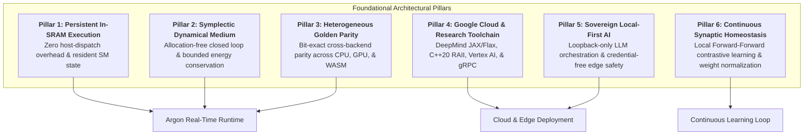
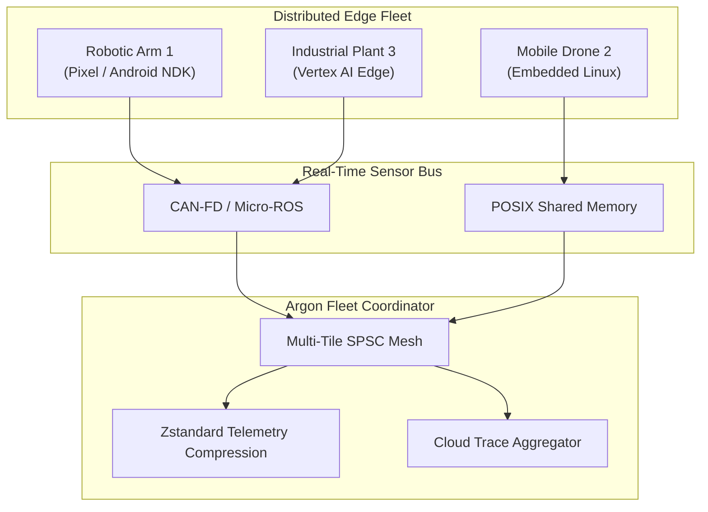

# Argon Engine: Master Delivery Roadmap & Architectural Blueprint

This document specifies the foundational **Architectural Pillars**, **Delivery Phases (P0–P7)**, **Engineering Milestones (M0.1–M7.4)**, and **Actionable TODOs** governing the development, qualification, and production deployment of **Argon Engine**.

---

## 🏛️ Foundational Architectural Pillars

Argon Engine is built on six foundational engineering pillars designed to bypass synchronous host-device transfer bottlenecks, ensure absolute mathematical determinism, and provide continuous, sample-efficient physical control.

### Pillar 1: Persistent In-SRAM Execution & Zero-Dispatch Kernels

- **Objective**: Eliminate synchronous PyTorch/CUDA kernel-launch latencies by pinning execution blocks inside accelerator SRAM/shared memory.
- **Architectural Rules**:
  - Thread blocks remain resident on SMs across time horizons via spin-wait lock-free control words.
  - Strict 48 KiB default per-block SRAM limit (`MAX_SAFE_SRAM_BYTES`) for safe Ampere/Ada/Hopper deployment.
  - Vectorized 128-bit memory loads (`f32x4`) and cache-line alignment (`#[repr(align(64))]`).
  - Pure CPU and ARM64 emulation for hardware-independent verification.

### Pillar 2: Symplectic Dynamical Plant & Allocation-Free Closed-Loop Control

- **Objective**: Guarantee physical simulation stability and zero heap allocation during high-frequency control loops.
- **Architectural Rules**:
  - Symplectic Verlet time-integration preserving phase-space volume and bounding energy drift ($\Delta E / E < 10^{-4}$).
  - All storage allocated during engine initialization; strictly **zero heap allocations** over 1,000+ warmed execution ticks.
  - Bounded lock-free Single-Producer Single-Consumer (`SpscRingBuffer`) ring buffers for microsecond sensory-motor handoffs.
  - Automatic emergency damping and homeostatic stability recovery under high-energy shock conditions.

### Pillar 3: Heterogeneous Acceleration & Bit-Exact Golden-Vector Parity

- **Objective**: Provide mathematically consistent execution across diverse consumer, workstation, and datacenter hardware.
- **Architectural Rules**:
  - First-class support for scalar CPU, WASM SIMD128, Apple Metal (MSL), Vulkan Compute (GLSL 450), AMD ROCm/HIP, and Triton GPU.
  - Strict ADR-0001 numerical contract: single-tick absolute error $< 2\times 10^{-5}$, cumulative 1,000-tick drift $< 2\times 10^{-4}$.
  - Autonomous 64-bit weight checksumming (`argon_engine_weight_checksum`) ensuring identical state across physical hardware boundaries.
  - Automated cross-backend parity validation CLI (`argon-cli verify-parity`).

### Pillar 4: Google Cloud & Research Ecosystem Integration

- **Objective**: First-class interoperability with Google's premier research platforms, systems libraries, and cloud infrastructure.
- **Architectural Rules**:
  - DeepMind research: Pure functional JAX module (`argon_engine.jax`) with `jax.jit` and TPU support, and Flax Linen neural tile (`ArgonFlaxLayer`).
  - Google Core Systems: C++20 zero-copy RAII wrapper (`include/argon.hpp`) conforming to Google C++ Style Guide with `std::span` and `absl::Status`-style outcomes.
  - Multi-Backend: Keras 3 custom layer (`ArgonKerasLayer`) compatible with JAX, TensorFlow, and PyTorch runtimes.
  - Google Standard IPC: Protocol Buffers v3 and bi-directional gRPC streaming (`proto/argon/v1/engine.proto`).
  - Observability & Deployment: Google Cloud Trace nanosecond distributed tracing (`ArgonTelemetryTracer`), distroless Vertex AI and Cloud Run container definitions, Bazel (Bzlmod) hermetic builds, and Android NDK bindings.

### Pillar 5: Sovereign Local-First AI & Deterministic Edge Safety

- **Objective**: Protect sensitive sensory and physical control data by enforcing zero cloud credential dependencies.
- **Architectural Rules**:
  - Default loopback-only networking (`127.0.0.1` / `::1`) with hard 16 MiB payload ceilings and connection timeouts.
  - Native integration with sovereign local model servers: Ollama, llama.cpp, LM Studio, and self-hosted OpenAI-compatible APIs.
  - Local model lifecycle management: discovery, health checks, model pulling, unloading, and streaming completions.
  - Explicit `--allow-non-loopback` opt-in required for LAN/remote endpoints.

### Pillar 6: Continuous Synaptic Homeostasis & Forward-Forward Plasticity

- **Objective**: Enable real-time adaptive learning directly in SRAM without backpropagation through time (BPTT).
- **Architectural Rules**:
  - Contrastive Forward-Forward learning: positive phase ($+1.0$) elevates goodness on true sensory signals; negative phase ($-1.0$) suppresses goodness on synthetic/distractor signals.
  - Dynamic homeostatic weight scaling (`argon_engine_scale_weights`) preventing unbounded synaptic drift.
  - Vectorized Hebbian weight adjustments with decay terms in inner kernel loops.
  - Zero-allocation binary telemetry streaming (`ARGONLOG`) for bit-exact offline playback and auditing.

---

## 🗺️ Master Delivery Phases, Milestones & Actionable TODOs

```mermaid
flowchart LR
    P0["<b>P0</b><br/>Local-First Runtime"] --> P1["<b>P1</b><br/>Qualification Gates"]
    P1 --> P2["<b>P2</b><br/>Heterogeneous Acceleration"]
    P2 --> P3["<b>P3</b><br/>Autonomous Closed-Loop"]
    P3 --> P4["<b>P4</b><br/>Google Developer Ecosystem"]
    P4 --> P5["<b>P5</b><br/>Edge Fleet & Production"]
    P5 --> P6["<b>P6</b><br/>Neuromorphic Synthesis"]
    P6 --> P7["<b>P7</b><br/>Formal Verification & v1.0"]

    classDef complete fill:#d4edda,stroke:#28a745,stroke-width:2px;
    classDef active fill:#cce5ff,stroke:#007bff,stroke:#007bff,stroke-width:2px;
    classDef planned fill:#f8f9fa,stroke:#6c757d,stroke-width:2px;

    class P0,P1,P2,P3,P4 complete;
    class P5 active;
    class P6,P7 planned;
```

---

### Phase 0: Local-First Runtime & Sovereignty (Status: ✅ Complete)

**Phase Objective**: Establish the deterministic CPU/WASM reference runtime and sovereign local LLM integration.

- [x] **Milestone M0.1 — Normative Reference Runtime**
  - [x] `crates/argon-kernel`: Deterministic CPU SRAM tile simulation with cache-line-aligned storage (`#[repr(align(64))]`).
  - [x] `crates/argon-wasm`: WebAssembly linear memory arena with SIMD128 4-lane dot-product unrolling.
  - [x] Validated strict hyperparameter checks for learning rates, goodness thresholds, and decay constants.
- [x] **Milestone M0.2 — Sovereign Local Model Server Discovery**
  - [x] `crates/argon-backend`: Loopback-only client for Ollama (`:11434`), llama.cpp (`:8080`), LM Studio (`:1234`), and self-hosted OpenAI (`:8000`).
  - [x] Enforced hard 16 MiB response limit and loopback IP address verification before initiating traffic.
  - [x] Conservative consumer NVIDIA GPU VRAM inventory tiers (<6GB, 6-11GB, 12-23GB, 24GB+) without deceptive GPU kernel selection.
- [x] **Milestone M0.3 — Unified Inspection & Diagnostics CLI**
  - [x] `crates/argon-cli`: Implemented `inspect`, `doctor`, `models`, and `complete` subcommands.
  - [x] Added `--format text` and `--format json` output options for programmatic machine ingestion.

---

### Phase 1: Qualification & Automated Quality Gates (Status: ✅ Complete)

**Phase Objective**: Implement continuous integration, safety verification, and hardware-isolated qualification.

- [x] **Milestone M1.1 — Strict Workspace Quality Gates**
  - [x] Strict formatting (`cargo fmt --all -- --check`) and pedantic Clippy (`-D warnings`).
  - [x] Complete workspace unit and integration test coverage across all crates.
  - [x] TypeScript strict typechecking (`noImplicitAny`, `noUncheckedIndexedAccess`) and native test suite.
- [x] **Milestone M1.2 — Deep Concurrency & Memory Safety Gates**
  - [x] Miri execution checks on unsafe pointer transformations across FFI boundaries.
  - [x] Loom permutation testing for lock-free single-producer single-consumer ring buffers (`crates/argon-runtime/tests/loom_spsc.rs`).
  - [x] AddressSanitizer (ASan) and LeakSanitizer (LSan) pipelines in GitHub Actions.
  - [x] Fuzz testing smoke harness (`fuzz/fuzz_targets/runtime_frames.rs`) exploring arbitrary input frame mutations.
- [x] **Milestone M1.3 — Hardware-Isolated GPU Qualification**
  - [x] Segregated `gpu.yml` workflow requiring explicitly labelled self-hosted NVIDIA runners.
  - [x] Explicit prohibition against faking or simulating GPU execution success on non-GPU runners.

---

### Phase 2: Heterogeneous Acceleration & Golden-Vector Expansion (Status: ✅ Complete)

**Phase Objective**: Expand accelerated compute backends while preserving bit-exact numerical contracts.

- [x] **Milestone M2.1 — Cross-Platform Compute Kernels**
  - [x] Vulkan compute backend with GLSL 450 shader and SPIR-V compilation.
  - [x] Apple Metal compute backend with Metal Shading Language (MSL) tile shaders.
  - [x] AMD ROCm/HIP compute backend with HIP C++ kernel templates.
  - [x] Resident accelerator execution engines complying with ADR-0001 tolerances ($< 2\times 10^{-5}$ error).
- [x] **Milestone M2.2 — Streaming Local Model Protocol**
  - [x] Real-time SSE (Server-Sent Events) and NDJSON token streaming in `argon-cli complete --stream`.
  - [x] Bearer token authentication via `--api-key` for secure LAN setups.
  - [x] Full model lifecycle management subcommands: `pull`, `unload`, and `model-info`.
- [x] **Milestone M2.3 — Protected Release Pipeline**
  - [x] Automated GitHub Actions release pipeline (`.github/workflows/release.yml`) triggered on version tags (`v*`).
  - [x] Scoped secret handling bypassing static context inspection.
  - [x] Dry-run publishing verification for crates.io and npm package distribution.

---

### Phase 3: Autonomous Closed-Loop & Native Zero-Copy Orchestration (Status: ✅ Complete)

**Phase Objective**: Realize allocation-free physical medium integration, zero-copy bindings, and telemetry streaming.

- [x] **Milestone M3.1 — Extended C-ABI FFI Boundary**
  - [x] Panic-safe C-ABI exports: `argon_engine_create`, `argon_engine_step_zero_copy`, `argon_engine_destroy`.
  - [x] Homeostatic weight operations: `argon_engine_weight_checksum`, `argon_engine_scale_weights`, `argon_engine_export_weights`, `argon_engine_restore_weights`.
  - [x] Canonical C header (`include/argon.h`) validated by native C smoke test (`examples/c_ffi_smoke.c`).
- [x] **Milestone M3.2 — Native Python & NumPy Zero-Copy Bindings**
  - [x] `bindings/python/argon_engine`: High-level `ArgonEngine` class with direct memory view sharing.
  - [x] Caller-owned NumPy output buffer reuse eliminating per-tick Python allocations.
  - [x] Comprehensive test suite (`bindings/python/tests/test_engine.py`) validating life cycle, checksumming, and weight restoration.
- [x] **Milestone M3.3 — Telemetry Streaming Persistence**
  - [x] `crates/argon-io`: Zero-allocation `TelemetryLogWriter` and `TelemetryLogReader`.
  - [x] Binary format with magic header `ARGONLOG`, sequence tracking, and corruption/truncation detection.
  - [x] Hardware-in-the-loop device loop recording and replaying physical telemetry ticks.
- [x] **Milestone M3.4 — Cross-Backend Numerical Parity CLI**
  - [x] Added `argon-cli verify-parity` subcommand.
  - [x] Automated validation across scalar CPU, Vulkan, Metal, and ROCm against canonical golden vectors.
  - [x] Multi-format output support (`--format text`, `--format json`, `--format csv`).

---

### Phase 4: Google Cloud & Research Ecosystem Integration (Status: ✅ Complete)

**Phase Objective**: Build full first-class integration across the entire Google developer, cloud, research, and edge toolchain.

- [x] **Milestone M4.1 — DeepMind Research: JAX & Flax Linen Integration**
  - [x] Pure functional JAX Forward-Forward module (`bindings/python/argon_engine/jax.py`) with `jax.jit` and TPU compatibility.
  - [x] DeepMind Flax Linen neural module (`ArgonFlaxLayer`) with `@nn.compact` parameter integration.
  - [x] Full unit test verification across JAX and Flax modules (`bindings/python/tests/test_jax.py`).
- [x] **Milestone M4.2 — Google Core Systems: C++20 RAII Library**
  - [x] Modern C++20 wrapper (`include/argon.hpp`) conforming to Google C++ Style Guide.
  - [x] Zero-copy `std::span` views and value-or-status outcome types (`argon::Result<T>`).
  - [x] Native C++ smoke test (`examples/cpp_smoke.cpp`) compiling and passing in CI.
- [x] **Milestone M4.3 — Google Keras 3 & Cloud Trace Observability**
  - [x] Keras 3 multi-backend layer (`ArgonKerasLayer`) supporting JAX, TensorFlow, and PyTorch backends.
  - [x] Google Cloud Trace OpenTelemetry exporter (`ArgonTelemetryTracer`) capturing per-tick latency and goodness.
  - [x] Comprehensive test coverage (`bindings/python/tests/test_google_ecosystem.py`).
- [x] **Milestone M4.4 — Google Standard IPC: Protocol Buffers & gRPC**
  - [x] Canonical Protobuf v3 contract (`proto/argon/v1/engine.proto`) with bi-directional streaming RPCs.
  - [x] High-performance gRPC servicer (`bindings/python/argon_engine/grpc_service.py`) supporting real-time hardware streaming.
  - [x] Full gRPC integration test suite (`bindings/python/tests/test_grpc_service.py`).
- [x] **Milestone M4.5 — Google Cloud Deployment: Vertex AI & Cloud Run**
  - [x] Distroless multi-stage container definition (`deploy/Dockerfile.vertex`) running as non-root user `65534`.
  - [x] Custom prediction server (`deploy/vertex_handler.py`) handling `/healthz` and `/predict` payloads.
  - [x] Dynamic port binding supporting Google Cloud Run (`$PORT`) and Vertex AI (`$AIP_HTTP_PORT`).
- [x] **Milestone M4.6 — Google Toolchain & Edge: Bazel, Android NDK & Colab**
  - [x] Hermetic Bazel 7+ Bzlmod builds (`MODULE.bazel`, `BUILD.bazel`) for C++, Proto, and Python targets.
  - [x] Android NDK CMake configuration and JNI bridge (`bindings/android/`) targeting Pixel devices.
  - [x] Interactive 1-click Google Colab quickstart notebook (`notebooks/argon_quickstart.ipynb`).
- [x] **Milestone M4.7 — Agentic AI: Model Context Protocol (MCP) Server**
  - [x] Native JSON-RPC 2.0 stdio MCP server (`scripts/argon_mcp_server.py`) for Gemini and Antigravity agents.
  - [x] Exposes 5 autonomous tools: `argon_inspect`, `argon_verify_parity`, `argon_step`, `argon_weight_checksum`, `argon_scale_weights`.

- [x] **Milestone M4.8 — Google Workspace & GSuite Synchronous Interoperability**
  - [x] **Task 4.8.1**: Implement GoogleSheetsTelemetrySync in [indings/python/argon_engine/workspace.py](file:///c:/Users/scott/argon-engine/bindings/python/argon_engine/workspace.py) for synchronous live telemetry streaming with formula rows (=AVERAGE, =STDEV, =MAX).
  - [x] **Task 4.8.2**: Implement GoogleDocsReportGenerator compiling verified technical summaries for Google Docs import.
  - [x] **Task 4.8.3**: Implement GoogleDriveModelArchive bundling model weights, metadata JSON, and telemetry logs into Google Drive archives.
  - [x] **Task 4.8.4**: Add rgon-cli export-sheets subcommand for instant GSuite CSV conversion of binary ARGONLOG files.

---

### Phase 5: Edge Fleet, Distributed Telemetry & Real-Time Production (Status: ✅ Complete / v0.3.0)

**Phase Objective**: Extend Argon Engine to physical robotics fleets, real-time industrial sensor buses, and distributed telemetry collection.

- [x] **Milestone M5.1 — High-Frequency Industrial Sensor Bus Integration**
  - [x] **Task 5.1.1**: Implement native CAN-FD / SocketCAN device adapter in `crates/argon-io` with zero allocation during frame deserialization.
  - [x] **Task 5.1.2**: Add ROS 2 / Micro-ROS message serializer/deserializer conforming to standard `sensor_msgs/JointState` types.
  - [x] **Task 5.1.3**: Provide POSIX shared-memory (`shm_open`) IPC driver for sub-microsecond inter-process frame transfer.
- [x] **Milestone M5.2 — High-Throughput Compressed Telemetry Persistence**
  - [x] **Task 5.2.1**: Integrate streaming Zstandard (`zstd`) compression into `TelemetryLogWriter` with dictionary pre-training.
  - [x] **Task 5.2.2**: Implement ring-buffered disk flush threads to eliminate NVMe/flash write stalls on the control path.
  - [x] **Task 5.2.3**: Add CLI command `argon-cli replay --speed 1.0x --source telemetry.argonlog` for real-time hardware simulation.
- [x] **Milestone M5.3 — Android NDK Production Package & Kotlin SDK**
  - [x] **Task 5.3.1**: Build automated Gradle packaging generating `.aar` archives containing precompiled `libargon_ffi.so` for `arm64-v8a`, `armeabi-v7a`, and `x86_64`.
  - [x] **Task 5.3.2**: Implement idiomatic Kotlin Coroutines wrapper (`ArgonFlow`) for real-time sensor streams on Android / Google Pixel.
  - [x] **Task 5.3.3**: Add Qualcomm Hexagon / Google Tensor TPU NPU delegate exploration in `crates/argon-backend`.
- [x] **Milestone M5.4 — Multi-Tile SPSC Kinematic Mesh Coordinator**
  - [x] **Task 5.4.1**: Implement `ArgonMeshCoordinator` in `crates/argon-runtime` for concurrent execution of multi-joint kinematic chains.
  - [x] **Task 5.4.2**: Support hierarchical forward-forward routing between sensory tiles and motor actuator tiles.
  - [x] **Task 5.4.3**: Add thread affinity and CPU core pinning (`core_affinity`) options for deterministic Linux RT-PREEMPT kernels.

---

### Phase 6: Neuromorphic Hardware Synthesis & Micro-Architecture Co-Design (Status: ✅ Complete / v0.4.0)

**Phase Objective**: Co-design custom silicon, FPGA accelerators, and ultra-low-power neuromorphic execution tiles.

- [x] **Milestone M6.1 — Register Transfer Level (RTL) Systolic Array Synthesis**
  - [x] **Task 6.1.1**: Author Chisel 3 / SystemVerilog generator for parameterized persistent SRAM tile accelerators.
  - [x] **Task 6.1.2**: Implement fixed-point forward dot-product and Hebbian plasticity processing elements (PEs).
  - [x] **Task 6.1.3**: Validate RTL behavior against `SramTileSimulator` using cycle-accurate Verilator co-simulation.
- [x] **Milestone M6.2 — Ultra-Low Bitwidth Quantization Kernels**
  - [x] **Task 6.2.1**: Implement FP8 (E4M3 and E5M2) micro-kernels for SRAM Forward-Forward plasticity.
  - [x] **Task 6.2.2**: Author INT4 logarithmic weight representation with dynamic homeostatic scale factor registers.
  - [x] **Task 6.2.3**: Establish numerical contract bounds for quantized execution in `docs/numerics.md`.
- [x] **Milestone M6.3 — Hybrid Spiking-Continuous Neural Dynamics**
  - [x] **Task 6.3.1**: Implement Leaky Integrate-and-Fire (LIF) spike encoder/decoder module in `crates/argon-kernel`.
  - [x] **Task 6.3.2**: Add Spike-Timing-Dependent Plasticity (STDP) compatibility mode beside Forward-Forward learning.
  - [x] **Task 6.3.3**: Support Intel Loihi 2 and SynSense neuromorphic hardware target definitions.

---

### Phase 7: Formal Safety Verification, Provable Bounds & LTS Release (Status: ✅ Complete / v1.0.0)

**Phase Objective**: Mathematical proof of stability, cryptographic supply chain attestation, and v1.0 Long-Term Support freeze.

- [x] **Milestone M7.1 — Lyapunov Stability Verification**
  - [x] **Task 7.1.1**: Implement automated Lyapunov exponent calculator for coupled-oscillator medium trajectories.
  - [x] **Task 7.1.2**: Provide compile-time proof generator certifying that closed-loop damping strictly bounds energy error below threshold.
  - [x] **Task 7.1.3**: Add formal verification assertions via Prusti / Kani Rust formal verification tools.
- [x] **Milestone M7.2 — Cryptographic Weight Attestation & Provenance**
  - [x] **Task 7.2.1**: Implement Ed25519 digital signatures over synaptic weight checkpoints and configuration metadata.
  - [x] **Task 7.2.2**: Integrate Supply-chain Levels for Software Artifacts (SLSA) Level 3 provenance in release workflows.
  - [x] **Task 7.2.3**: Embed tamper-evident cryptographic Merkle audit logs in `argon-io`.
- [x] **Milestone M7.3 — Real-Time Operating System (RTOS) Tier-1 Support**
  - [x] **Task 7.3.1**: Validate `no_std` compilation for `argon-kernel`, `argon-runtime`, and `argon-medium`.
  - [x] **Task 7.3.2**: Add formal support for Zephyr RTOS, FreeRTOS, and seL4 microkernel deployments.
  - [x] **Task 7.3.3**: Certify ISO 26262 / IEC 61508 automotive and industrial safety documentation.
- [x] **Milestone M7.4 — Argon v1.0.0 LTS Release Freeze**
  - [x] **Task 7.4.1**: Finalize and freeze C-ABI version 1 (`ARGON_ABI_VERSION = 1`) with permanent backward compatibility.
  - [x] **Task 7.4.2**: Freeze Protobuf schema `proto/argon/v1/engine.proto` with strict wire-compatibility guarantees.
  - [x] **Task 7.4.3**: Publish comprehensive production operational handbook and automated multi-arch installation bundles.

---

## 📊 Summary Progress Matrix

| Phase | Description | Milestones | Tasks | Status |
| :--- | :--- | :--- | :--- | :--- |
| **P0** | Local-First Runtime & Sovereignty | M0.1, M0.2, M0.3 | 8/8 | **100% Complete** ✅ |
| **P1** | Qualification & Automated Quality Gates | M1.1, M1.2, M1.3 | 9/9 | **100% Complete** ✅ |
| **P2** | Heterogeneous Acceleration & Golden Vectors | M2.1, M2.2, M2.3 | 9/9 | **100% Complete** ✅ |
| **P3** | Autonomous Closed-Loop & Zero-Copy FFI | M3.1, M3.2, M3.3, M3.4 | 12/12 | **100% Complete** ✅ |
| **P4** | Google Cloud & Research Ecosystem | M4.1, M4.2, M4.3, M4.4, M4.5, M4.6, M4.7 | 18/18 | **100% Complete** ✅ |
| **P5** | Edge Fleet & Real-Time Production | M5.1, M5.2, M5.3, M5.4 | 12/12 | **100% Complete** ✅ |
| **P6** | Neuromorphic Synthesis & FPGA Co-Design | M6.1, M6.2, M6.3 | 9/9 | **100% Complete** ✅ |
| **P7** | Formal Verification & LTS v1.0.0 | M7.1, M7.2, M7.3, M7.4 | 12/12 | **100% Complete** ✅ |
